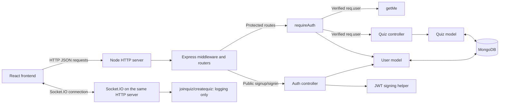
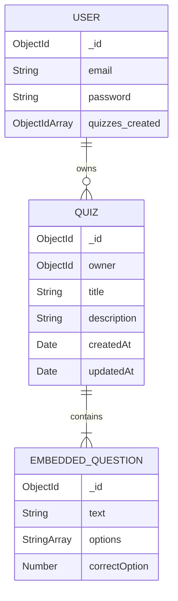

# Quizzo backend: project overview and developer guide

This guide explains what the backend does, how a request travels through it, how it stores data, and how the current React frontend uses it. It describes the source reviewed on **25 October 2026**, including unfinished features and older files that are not used by the running server.

The companion [frontend overview](../../quizzo_frontend/documentation/overview.md) covers the browser screens and user journey. The frontend folder uses the name Quizzo, while several screens display **QUIZLY**; both refer to this application.

## Contents

1. [What the backend is responsible for](#1-what-the-backend-is-responsible-for)
2. [Architecture and technology](#2-architecture-and-technology)
3. [Folder and file map](#3-folder-and-file-map)
4. [Startup, configuration, and request handling](#4-startup-configuration-and-request-handling)
5. [HTTP API reference](#5-http-api-reference)
6. [Authentication and JWT workflow](#6-authentication-and-jwt-workflow)
7. [Creating a quiz](#7-creating-a-quiz)
8. [Listing the current user's quizzes](#8-listing-the-current-users-quizzes)
9. [Database models and relationships](#9-database-models-and-relationships)
10. [Socket.IO and live quiz functionality](#10-socketio-and-live-quiz-functionality)
11. [How the frontend uses the backend](#11-how-the-frontend-uses-the-backend)
12. [Local setup and troubleshooting](#12-local-setup-and-troubleshooting)
13. [Current limitations and implementation details](#13-current-limitations-and-implementation-details)
14. [Reading guide and verification](#14-reading-guide-and-verification)

## 1. What the backend is responsible for

Quizzo currently lets a user register, sign in, build multiple-choice quizzes, save them, and see a list of the quizzes they own. The backend is the Node.js program that receives the frontend's requests and stores the lasting data in MongoDB.

For example, typing a question into the browser does not immediately send it to this server. The frontend keeps a draft in memory. When the user selects FINISH QUIZ, it submits the complete draft. The backend then verifies the user's token, checks the quiz data, assigns ownership, stores the quiz, and returns a summary of the saved record.

The backend currently implements five application HTTP endpoints and two preliminary socket event handlers.

| Responsibility | Current behavior |
| --- | --- |
| Register an account | Creates a user document from an email and password; validation and duplicate/error handling are incomplete. |
| Sign in | Compares credentials and returns a signed JWT for a successful match. |
| Resolve a signed-in user | Verifies a token and returns the corresponding user document. |
| Save a quiz | Validates title, description, questions, options, and correct-answer indexes before creating a quiz owned by the authenticated user. |
| List owned quizzes | Returns summaries of that user's quizzes, newest first. |
| Receive socket events | Accepts `join-quiz` and `create-quiz` events and logs messages. |
| Run a live game | Not implemented: no room creation, lobby, question broadcast, answer submission, scoring, timer, or leaderboard. |
| Fully manage saved quizzes | Only create and list are implemented; there is no single-quiz detail, update, or delete endpoint. |

The backend does not render the React UI or serve its production build. The frontend and backend run as separate applications and communicate over the network.

Some vocabulary used in the code:

| Term | Meaning here |
| --- | --- |
| HTTP endpoint | A method and URL handled by the server, such as `POST /api/quizzes`. |
| Router | An Express object that maps related paths to handlers. |
| Middleware | A function that runs before a controller; `requireAuth` verifies the user before protected operations. |
| Controller | A function that handles a request, performs application work, and sends a response. |
| `req` / `res` / `next` | Express's request, response, and function for moving to the next handler. |
| Model/schema | Mongoose's definition of a document's fields and rules, plus methods for querying and saving it. |
| Document/collection | A MongoDB record and the group of records it belongs to. |
| ObjectId | MongoDB's identifier type, generally serialized as a 24-character string in JSON. |
| JWT | A signed token the client presents as proof of a previous successful sign-in. |
| Socket.IO | A persistent event connection used here as the starting point for possible live quiz features. |

## 2. Architecture and technology

### 2.1 Main layers

The backend is one Node.js process with an Express application and a Socket.IO server sharing a Node HTTP server. It uses Mongoose to communicate with MongoDB.



The usual protected request follows this sequence:

```text
Browser API helper
  -> Express body/CORS middleware
  -> Router matches method and path
  -> requireAuth verifies JWT and loads user
  -> Controller validates and performs the operation
  -> Mongoose reads or writes MongoDB
  -> Controller sends JSON
  -> Frontend updates its state and screen
```

There is no separate service/repository layer, task queue, cache, or background worker in this folder. Controllers call Mongoose models directly. Authentication has small helper modules for user creation and token signing.

### 2.2 Dependencies

The following installed versions were inspected while preparing this guide; `package.json` declares compatible ranges and `package-lock.json` records dependency resolution.

| Package | Installed version | Use in this backend |
| --- | --- | --- |
| `express` | 5.2.1 | HTTP middleware, routers, and responses. |
| `cors` | 2.8.5 | Browser cross-origin access configuration. |
| `dotenv` | 17.2.3 | Loads environment values from `.env`. |
| `mongoose` | 9.0.1 | Schemas, validation, document models, and database operations. |
| `mongodb` | 7.0.0 | Direct dependency; imported symbols in application code are unused. Active database operations use Mongoose. |
| `jsonwebtoken` | 9.0.3 | Signs and verifies JWTs. |
| `socket.io` | 4.8.3 | Attaches socket event handling to the HTTP server. |
| `js-cookie` | 3.0.5 | Listed dependency, but not imported or used by the backend. |
| `nodemon` | 3.1.14 | Development dependency that restarts the server when files change. |

The package uses `"type": "commonjs"`, so active modules use `require(...)` and `module.exports`. It does not have a TypeScript compilation step or a build script.

The installed Mongoose and MongoDB packages require Node.js 20.19 or newer. Node 24.22.1 was used for the checks in this guide.

## 3. Folder and file map

```text
quizzo_backend/
├── controllers/
│   ├── auth.controller.js          signup, signin, getMe
│   ├── jwt.maker.controller.js      JWT signing helper
│   ├── user.create.controller.js    user creation helper
│   ├── quiz.controller.js          active quiz create/list handlers
│   ├── SocketController.js         socket logging handlers
│   ├── quiz.create.controller.js   unused older quiz creation helper
│   └── qtable.create.controller.js unused older question creation helper
├── documentation/
│   └── overview.md                 this guide
├── middlewares/
│   └── requireAuth.js              JWT verification and req.user assignment
├── models/
│   ├── users.model.js              active user model
│   ├── quizzes.model.js            active quiz + embedded question schemas
│   └── qtable.model.js             unused standalone Question model
├── routes/
│   ├── auth.routes.js              /signup, /signin, /me
│   └── quiz.routes.js              GET / and POST / under /api/quizzes
├── app.js                          executable HTTP/Socket.IO entry point
├── db.js                           Mongoose connection helper
├── env.js                          unused ES-module configuration prototype
├── .env                            local environment values; ignored by Git
├── .gitignore                      excludes node_modules/, .env, and data/
├── package.json                    dependencies and run scripts
└── package-lock.json               npm dependency lockfile
```

`node_modules/` is installed dependency code. The ignored `data/` path does not determine where the application stores quiz data; database storage is selected by `MONGOURL`. There is no backend README, test suite, or lint configuration in the reviewed source.

### 3.1 Active entry points and exports

| File | Export or entry point | Responsibility |
| --- | --- | --- |
| [`app.js`](../app.js) | Executed directly; no app/server export. | Loads configuration, installs middleware/routes, attaches Socket.IO, starts listening, and starts DB connection. |
| [`db.js`](../db.js) | `{ connectDB }` | Connects Mongoose and logs connection success/failure. |
| [`routes/auth.routes.js`](../routes/auth.routes.js) | Router directly. | Mounts auth handlers; `/me` uses `requireAuth`. |
| [`routes/quiz.routes.js`](../routes/quiz.routes.js) | Router directly. | Mounts protected quiz creation and listing. |
| [`middlewares/requireAuth.js`](../middlewares/requireAuth.js) | `{ requireAuth }` | Reads and verifies a token, finds its user, sets `req.user`, and calls `next()`. |
| [`controllers/auth.controller.js`](../controllers/auth.controller.js) | `{ signup, signin, getMe }` | Account registration, credential check, and current-user response. |
| [`controllers/user.create.controller.js`](../controllers/user.create.controller.js) | `user_create` function directly. | Creates a user with an empty `quizzes_created` array. |
| [`controllers/jwt.maker.controller.js`](../controllers/jwt.maker.controller.js) | `{ jwtmaker }` | Calls `jwt.sign` and returns the token. |
| [`controllers/quiz.controller.js`](../controllers/quiz.controller.js) | `{ createQuiz, getMyQuizzes }` | Validates/stores quizzes and fetches owner-filtered summaries. |
| [`controllers/SocketController.js`](../controllers/SocketController.js) | `{ joinquiz, createquiz }` | Logs a message for the two socket events. |
| [`models/users.model.js`](../models/users.model.js) | `{ User }` | Registers the Mongoose model named `user`. |
| [`models/quizzes.model.js`](../models/quizzes.model.js) | `Quiz` model directly. | Registers the quiz model and its embedded question schema. |

The export styles differ. For example, `const { User } = require(...)` is correct for the user model, while `const Quiz = require(...)` is correct for the quiz model.

### 3.2 Files outside the active request path

| File | What it contains | Why it is separate from the implemented API |
| --- | --- | --- |
| [`env.js`](../env.js) | An object with fallback MongoDB URL, CORS origin, and `BACKEND_PORT`. | Nothing imports it. It uses `import`/`export` despite the package being CommonJS and currently fails Node's syntax check in that context. |
| [`models/qtable.model.js`](../models/qtable.model.js) | A standalone `Question` model with timing and answer-user fields. | Active quizzes embed their own questions instead. |
| [`controllers/qtable.create.controller.js`](../controllers/qtable.create.controller.js) | `qtable_create`, which creates one fixed example question. | No route or active controller calls it. |
| [`controllers/quiz.create.controller.js`](../controllers/quiz.create.controller.js) | `quiz_create`, which attempts to save fixed legacy `quiz_id` / `author_id` fields. | No route calls it; its destructured Quiz import and payload do not match the current model. |

The similarly named functions are different: REST `createQuiz` saves a real quiz, socket `createquiz` only logs, and legacy `quiz_create` is unused.

## 4. Startup, configuration, and request handling

### 4.1 What happens when the server starts

Both supported scripts ultimately execute `app.js`:

```text
npm start    -> node app.js
npm run dev  -> nodemon app.js
```

Startup proceeds as follows:

1. `dotenv.config()` loads environment values.
2. `app.js` imports the DB helper, routers, and socket controllers. Importing routers also imports their controllers and models.
3. `express()` creates the application.
4. The app installs URL-encoded body parsing, CORS, and JSON body parsing, in that order.
5. It mounts auth routes at `/api/auth` and quiz routes at `/api/quizzes`.
6. `createServer(app)` creates one Node HTTP server around Express.
7. `new Server(httpServer, ...)` attaches Socket.IO to that server.
8. The socket connection callback registers the two event handlers.
9. `httpServer.listen(process.env.PORT, ...)` starts listening.
10. The listen callback logs the port and calls `connectDB()`.

The database connection is initiated **after the HTTP server starts listening**. The server does not wait for MongoDB before accepting requests. `connectDB()` catches and logs connection errors without exiting the process or marking it unready. Some database operations can therefore wait or fail even while the HTTP port is open.

There is no health/readiness endpoint, explicit graceful-shutdown handler, or application-level DB retry policy. Driver-level behavior is left to the libraries' defaults.

### 4.2 Configuration actually used

| Variable | Used by | Meaning |
| --- | --- | --- |
| `PORT` | `app.js` | HTTP and Socket.IO listening port. Set it explicitly, normally to `4444` for this frontend. |
| `CORS_ORIGIN` | Express CORS and Socket.IO options in `app.js` | Browser frontend origin allowed by the configured CORS policy, for example `http://localhost:5173`. |
| `MONGOURL` | `db.js` | MongoDB connection string, including the intended database. |
| `JWT_SECRET` | Auth controller and `requireAuth` | Secret used to sign and verify tokens. |

The server declares `const PORT = process.env.PORT || 4444`, but the listen call does not use that variable. The apparent 4444 fallback is therefore not the value passed to `listen` when the environment is missing.

`BACKEND_PORT` is mentioned only in the unused `env.js`. Its defaults for MongoDB and CORS are also inactive. The active DB helper passes `process.env.MONGOURL` directly to Mongoose.

Several modules call `dotenv.config()` again. They read the same process environment; they do not establish independent configurations. Run the scripts from the backend directory so the default `.env` lookup matches the intended project.

### 4.3 Express middleware and CORS

`express.json()` makes JSON request bodies available as `req.body`. `express.urlencoded({ extended: true })` also accepts URL-encoded form bodies, although the current frontend sends JSON. The auth router installs another `express.json()` middleware even though JSON parsing is already configured globally.

Express CORS uses `{ origin: process.env.CORS_ORIGIN, credentials: true }`. Socket.IO separately receives the same origin value. The credentials flag does not create a login session or set a cookie; current authentication uses a bearer token explicitly sent by the client.

CORS controls browser cross-origin access. It does not authenticate a request or replace `requireAuth`.

There is no custom JSON error middleware, fallback route, or static frontend hosting configured. Unknown application paths, including a direct `GET /`, use Express's default not-found behavior. Body-parser errors and forwarded controller errors can use Express's default error responses rather than the quiz controller's JSON format.

### 4.4 Database connection helper

`connectDB()` installs a one-time Mongoose `open` listener, then awaits `mongoose.connect(process.env.MONGOURL)`. On connection, it logs the connected host and database name. On failure, it logs `MongoDB connection error`.

Models use Mongoose's shared default connection. There is no separately instantiated `MongoClient`, despite its unused import in `app.js`, and no application code that stores quiz records in local files.

## 5. HTTP API reference

These are the five explicitly declared application endpoints. Examples assume a server running at `http://localhost:4444`.

| Method and full path | Protection | Handler | Successful response |
| --- | --- | --- | --- |
| `POST /api/auth/signup` | Public | `signup` | Normally `200` with the created user document. |
| `POST /api/auth/signin` | Public | `signin` | `200` with `{ token }` when credentials match. |
| `GET /api/auth/me` | `requireAuth` | `getMe` | `200` with `{ user }`. |
| `POST /api/quizzes` | `requireAuth` | `createQuiz` | `201` with `{ message, quiz }`. |
| `GET /api/quizzes` | `requireAuth` | `getMyQuizzes` | `200` with `{ quizzes: [...] }`. |

The quiz router registers `/` for both GET and POST; the `/api/quizzes` prefix comes from `app.use`. There is no `/api/quizzes/:id` route, separate question endpoint, account profile update, logout route, password reset, or token-refresh route.

Protected requests use this header convention:

```http
Authorization: Bearer <jwt-returned-by-signin>
```

Requests with bodies use `Content-Type: application/json`. Authentication and quiz responses do not share a uniform envelope: signup returns a raw document, sign-in returns a token object, `/me` wraps a user, and quiz operations return summaries. The following sections show each contract and its current failure behavior.

## 6. Authentication and JWT workflow

### 6.1 Signup: create the user record

The client sends:

```http
POST /api/auth/signup
Content-Type: application/json
```

```json
{
  "email": "reader@example.com",
  "password": "example-password"
}
```

The values and IDs in all examples in this guide are synthetic.

The signup controller:

1. Reads `email` and `password` from `req.body`.
2. Calls `User.findOne({ email, password })` to look for a matching pair.
3. If no matching document exists, calls `user_create(email, password)`.
4. The helper creates `{ email, password, quizzes_created: [] }` with `User.create`.
5. The controller sends the created document using `res.json(user_created)`.

An illustrative success response is:

```json
{
  "_id": "65a000000000000000000002",
  "email": "reader@example.com",
  "password": "example-password",
  "quizzes_created": [],
  "__v": 0
}
```

The password appears here because the current code returns the raw document without filtering it. This is the present response shape, not a recommended account-response format. Signup does not generate a token or establish a session.

There are several important branches:

| Condition | Current result |
| --- | --- |
| No document matches both email and password | Attempts to create a user and returns it with the default `200` status. |
| A matching email/password pair already exists | Returns the string `user already present` from the JavaScript function, but does not send an HTTP response. The client can remain waiting. |
| The same email exists with a different password | The pair lookup can return no match, allowing another user with that email. There is no unique email index to prevent it. |
| An error reaches the signup controller's catch block | It logs the error without sending a failure response. |
| `user_create` fails internally | The helper logs and returns no document, so the controller can attempt `res.json(undefined)` instead of a structured error. |

Neither the controller nor the user schema enforces required email/password fields or email normalization. Model inspection also confirmed that an empty User document has no schema validation errors. Signup is therefore less strict than quiz creation.

### 6.2 Sign-in: exchange credentials for a token

The sign-in endpoint takes the same `{ email, password }` JSON body at `POST /api/auth/signin`.

Its successful path is:

1. Find a user by `email` using `User.findOne({ email })`.
2. Compare the stored password to the supplied password using strict equality.
3. Call `jwtmaker(process.env.JWT_SECRET, { mail: email })`.
4. Send `{ "token": "<signed-jwt>" }` with the default `200` status.

The helper calls `jwt.sign(obj, secret)` without additional options. The application payload contains `mail`; the library normally also adds an issued-at claim. The code does not configure an expiry, issuer, audience, refresh token, or server-side token store.

A JWT is signed data, not an encrypted user record. This token carries the email claim, not the password or the full user document.

| Condition | Current sign-in behavior |
| --- | --- |
| Email exists and password matches | Returns `{ token }`. |
| Email does not exist | Sends plain text `no user with this email` with the default success status. |
| Wrong password | Throws, then rethrows an Error from the catch block. Express 5 forwards the rejected async handler to its default error handling; no application JSON `401` is sent here. |
| JWT signing fails | `jwtmaker` catches/logs the error and returns `undefined`; the controller can still send an object whose undefined token property disappears during JSON serialization. |

The `res.send("wrong pwd")` line after the throw cannot run. Logging an error or returning from a function is not the same as completing an HTTP response.

### 6.3 `requireAuth`: verify every protected request

The middleware is mounted on `/api/auth/me`, `GET /api/quizzes`, and `POST /api/quizzes`.

It performs the following steps:

```text
req.headers.authorization
  -> split on a space and take the second item
  -> jwt.verify(token, JWT_SECRET)
  -> read decoded.mail
  -> User.findOne({ email: decoded.mail })
  -> confirm the user exists and email matches
  -> assign the entire document to req.user
  -> next()
```

The middleware does not separately check that the header exists or that its first word is `Bearer`. A missing header can throw during `.split`; malformed tokens or signature errors can throw during verification. All these errors go to the same catch block.

For valid requests, `req.user` is the database user document, including its `_id`. The quiz controller uses that ID to determine ownership. The token itself contains the email, so a user database lookup occurs for each protected request; there is no cached user session in the server.

The failure path currently logs without `res.status(...).json(...)` or `next(error)`. It neither sends an error nor continues to the controller. A request with an invalid token or missing user can therefore remain pending until the frontend's timeout. The no-user branch also uses `throw console.error(...)`, which throws the logger's return value rather than constructing an Error.

This explains an apparent inconsistency: the quiz controller has a `401` response for missing ownership, but invalid-token requests can stop in the middleware before reaching that check.

### 6.4 Current user: `/api/auth/me`

After `requireAuth` succeeds, `getMe` simply sends:

```js
res.status(200).json({ user: req.user });
```

There is no second query inside `getMe`; the middleware already loaded the user. There is also no output projection, so this response includes the stored password and other document fields.

The frontend calls this endpoint after receiving a token and when restoring a saved token after a refresh. It keeps the returned user in React state and uses that user to decide whether to render protected pages.

```mermaid
sequenceDiagram
    participant F as Frontend
    participant A as Auth controller
    participant U as User model / MongoDB
    participant J as JWT helper
    participant M as requireAuth
    F->>A: POST /api/auth/signin {email, password}
    A->>U: Find by email
    U-->>A: User document
    A->>A: Compare stored and submitted passwords
    A->>J: Sign {mail: email}
    J-->>A: JWT
    A-->>F: {token}
    Note over F: Store token in localStorage
    F->>M: GET /api/auth/me with bearer token
    M->>M: Verify token with JWT_SECRET
    M->>U: Find by decoded.mail
    U-->>M: User document
    M->>A: req.user assigned; call next()
    A-->>F: {user}
```

### 6.5 What logout means today

There is no logout or revocation endpoint. The frontend context's logout function removes its local token and user. The backend does not receive a logout notification or invalidate that JWT. No automatic token expiry is configured when issuing tokens.

The server has no host/player/admin role model. Every user who passes `requireAuth` can use the current create/list quiz operations, with listing restricted to their owner ID.

## 7. Creating a quiz

### 7.1 Request and ownership

The frontend sends the entire draft in one request:

```http
POST /api/quizzes
Authorization: Bearer <jwt>
Content-Type: application/json
```

```json
{
  "title": "JavaScript Basics",
  "description": "A short introductory quiz.",
  "questions": [
    {
      "text": "Which keyword declares a constant?",
      "options": ["let", "var", "const", "function"],
      "correctOption": 2
    }
  ]
}
```

`correctOption` is a zero-based array index. In this example, `2` refers to `const`, the third option. It is not an answer string or a one-based option number.

After middleware authentication, `createQuiz` gets the owner from `req.user?._id || req.user?.id` and checks it with `mongoose.isValidObjectId`. The client does not choose the owner by including an `owner` property in JSON.

### 7.2 Controller validation

The controller reads `title`, `description = ""`, and `questions` from `req.body || {}`. It validates the owner first, then the quiz fields, then every question. It stops at the first invalid value and sends a `400` error, rather than collecting all validation issues.

| Input | Rule applied by `createQuiz` |
| --- | --- |
| Owner | Must come from the authenticated user and be a valid ObjectId; otherwise `401`. |
| `title` | String, nonblank after trimming, at most 150 characters after trimming. |
| `description` | Optional string, at most 2,000 characters before controller trimming. Explicit `null` is invalid. |
| `questions` | Array containing 1 through 200 questions. |
| Question `text` | String, nonblank after trimming, at most 2,000 characters after trimming. |
| Question `options` | Array containing 2 through 10 choices. |
| Each option | String, nonblank after trimming, at most 500 characters after trimming. |
| Duplicate choices | Rejected after trimming and `toLocaleLowerCase()` normalization. |
| `correctOption` | Integer with `0 <= correctOption < options.length`. |

For example, `"Paris"` and `" paris "` are duplicates. A numeric string such as `"2"` for `correctOption` fails the controller's integer check even though Mongoose can cast some values in other contexts.

The controller constructs `cleanQuestions` containing only `text`, `options`, and `correctOption`. It does not pass the request body directly into the model. Extra fields such as client-generated question IDs, owner, timestamps, or status are not copied into the created document.

The current frontend offers exactly four options and lower character limits for several inputs. The backend's wider limits describe the API's capabilities, not additional fields or options already available in the UI.

### 7.3 Storage and success response

After validation, the controller calls:

```js
const quiz = await Quiz.create({
  title: title.trim(),
  description: description.trim(),
  questions: cleanQuestions,
  owner: ownerId,
});
```

Mongoose applies the schema's own casting and validation, gives the quiz and embedded questions their IDs, and handles timestamps. The quiz and its questions are stored together in one document. There is no separate insert into the legacy Question collection and no update of `User.quizzes_created`.

The controller awaits creation before sending HTTP `201`:

```json
{
  "message": "Quiz created successfully.",
  "quiz": {
    "id": "65a000000000000000000001",
    "title": "JavaScript Basics",
    "description": "A short introductory quiz.",
    "questionCount": 1,
    "createdAt": "2026-10-25T10:00:00.000Z"
  }
}
```

This is a summary. It uses `id` as the response field name even though MongoDB stores `_id`. `questionCount` is computed from `quiz.questions.length`; it is not a stored schema field. The response omits the owner, embedded question contents, and `updatedAt`.

The frontend treats the returned quiz ID as confirmation, clears its draft, and returns to the dashboard. There is no separate publish/deploy operation or saved status flag behind the builder's terminal-style wording.

### 7.4 Error responses

| Status | When returned by the quiz creation controller | Example/body |
| --- | --- | --- |
| `401` | `req.user` supplies no valid owner ID. | `{ "error": "Authenticated user not found." }` |
| `400` | A field fails the explicit controller rules. | `{ "error": "Title is required and must be at most 150 characters." }` |
| `400` | Mongoose raises `ValidationError` or `CastError`. | `{ "error": "Quiz data is invalid." }` |
| `500` | Another error occurs during creation. | `{ "error": "Unable to save the quiz. Please try again." }` |

Question-specific errors identify the question using a one-based display number, such as `Question 1 has an invalid correct option.` The underlying `correctOption` value remains zero-based.

These JSON responses belong to the controller. Parser errors, failures swallowed by `requireAuth`, or responses generated by Express before the controller can behave differently.

There is no request idempotency key, unique quiz-title rule, or duplicate-submission detection in the backend. If the database saves a quiz but the browser times out before receiving the response, resubmitting can create another record. The frontend's timeout message already accounts for this possibility.

## 8. Listing the current user's quizzes

`GET /api/quizzes` uses the same `requireAuth` middleware. The client provides only its bearer token; it does not provide an owner ID to select which account's list to return.

`getMyQuizzes` validates the owner ID, then runs:

```js
const quizzes = await Quiz.find({ owner: ownerId })
  .select("_id title description questions createdAt updatedAt")
  .sort({ createdAt: -1 })
  .lean();
```

Each part has a purpose:

- `find({ owner: ownerId })` restricts the results to the authenticated user.
- `select(...)` asks MongoDB for the fields needed to produce the summary. It includes the full questions array so the controller can count it.
- `sort({ createdAt: -1 })` puts recently created quizzes first.
- `lean()` returns plain JavaScript objects instead of hydrated Mongoose documents because this path only reads and formats data.

The controller maps every quiz to a response summary:

```json
{
  "quizzes": [
    {
      "id": "65a000000000000000000001",
      "title": "JavaScript Basics",
      "description": "A short introductory quiz.",
      "questionCount": 1,
      "createdAt": "2026-10-25T10:00:00.000Z",
      "updatedAt": "2026-10-25T10:00:00.000Z"
    }
  ]
}
```

The success status is `200`. An owner with no quizzes gets `{ "quizzes": [] }`, not a not-found error. Question text, choices, correct answers, and owner are not sent by this endpoint, even though questions are read from the database internally.

The controller returns `401` with `Authenticated user not found.` for an invalid owner and `500` with `Unable to fetch quizzes. Please try again.` for an unexpected query/mapping failure. The middleware timeout caveat also applies here.

There is no pagination, search, filtering by title, alternate sort, or limit parameter. Each request fetches all quizzes owned by the user. `User.quizzes_created` is not used in this query.

The dashboard's `MyQuizzes` component displays the returned titles and question counts. It fetches again when mounted after a successful save; no socket notification or shared frontend cache is involved.

## 9. Database models and relationships

### 9.1 Model names and collections

The model names registered in Mongoose and their default collection mappings were inspected locally without connecting to MongoDB:

| JavaScript export | Registered Mongoose name | Collection mapping | Used by active routes? |
| --- | --- | --- | --- |
| `User` | `user` | `users` | Yes. |
| `Quiz` | `Quiz` | `quizzes` | Yes. |
| `Question` | `Question` | `questions` | No; legacy code only. |

These mappings describe what Mongoose is configured to use, not a check of which collections or records currently exist in a live database.

The current persistence relationship is:



The embedded-question box represents objects inside `Quiz.questions`, not another collection. The relationship actually used for ownership is `Quiz.owner -> User._id`; the user-side `quizzes_created` array is not maintained by the active save flow.

### 9.2 User schema

[`users.model.js`](../models/users.model.js) defines:

| Field | Type and rules | Use |
| --- | --- | --- |
| `_id` | Generated ObjectId. | Identifies the user and becomes the owner of saved quizzes. |
| `email` | String; no required, trim, lowercase, or unique rule. | Signup/sign-in lookup and JWT `mail` claim. |
| `password` | String; no required rule or hashing hook. | Stored and compared directly during sign-in. |
| `quizzes_created` | Array of ObjectId references to `Quiz`. | Initialized to `[]` by `user_create`; otherwise unused by active quiz operations. |
| `__v` | Mongoose version field. | Default document metadata. |

The schema does not enable timestamps, declare a unique email index, or provide role, profile, password-reset, or refresh-token fields. MongoDB's document identifier and application validation are separate from enforcing a unique account email.

### 9.3 Quiz schema

[`quizzes.model.js`](../models/quizzes.model.js) defines the active quiz schema:

| Field | Type and rules |
| --- | --- |
| `_id` | Generated ObjectId. |
| `title` | Required String, trimmed, minimum length 1, maximum length 150. |
| `description` | String, trimmed, default `""`, maximum length 2,000. |
| `questions` | Required array of embedded question documents, with a custom length check of 1 through 200. |
| `owner` | Required ObjectId with `ref: "User"`; a schema index is declared on this field. |
| `createdAt`, `updatedAt` | Date fields maintained through `{ timestamps: true }`. |
| `__v` | Mongoose version field. |

The declared owner index supports owner-filtered queries. This guide checked its schema declaration, not the state of indexes on a running MongoDB instance. There is no declared unique quiz title, compound owner/date index, or stored `questionCount` field.

The `owner` reference names `User`, while the user model is registered as lowercase `user`. Current handlers query ObjectIds directly and never call `populate`, so they do not resolve that reference name. If population is introduced, the mismatch needs to be addressed. A Mongoose `ref` also does not by itself enforce that a referenced user document exists; the active controller obtains the owner from the database-backed authentication middleware.

### 9.4 Embedded question schema

| Field | Type and schema validation |
| --- | --- |
| `_id` | A generated ObjectId for each embedded question. |
| `text` | Required String, trimmed, maximum length 2,000. |
| `options` | Required String array; custom validation requires 2 through 10 nonblank choices, each at most 500 characters. |
| `correctOption` | Required Number, minimum 0; custom validation requires an integer below `this.options.length`. |

Every question has exactly one correct index in this active model. There is no duration, score weight, multiple-correct-answer flag, or submitted-answer record.

The model and controller provide different layers of validation. The controller requires the original request values to have the expected types and normalizes strings before saving. Mongoose can cast values and then enforces its schema. Duplicate-answer rejection is implemented in the controller, not in the schema's option validator; code that bypasses the controller would not receive that duplicate check.

A stored quiz is conceptually shaped like this:

```json
{
  "_id": "65a000000000000000000001",
  "title": "JavaScript Basics",
  "description": "A short introductory quiz.",
  "questions": [
    {
      "_id": "65a000000000000000000003",
      "text": "Which keyword declares a constant?",
      "options": ["let", "var", "const", "function"],
      "correctOption": 2
    }
  ],
  "owner": "65a000000000000000000002",
  "createdAt": "2026-10-25T10:00:00.000Z",
  "updatedAt": "2026-10-25T10:00:00.000Z",
  "__v": 0
}
```

The browser's temporary UUIDs are not stored as these question IDs. The frontend removes them from its payload, and the controller only copies the allowed question fields.

### 9.5 Legacy standalone Question schema

[`qtable.model.js`](../models/qtable.model.js) defines a separate, unused model with these fields:

| Field | Declared shape | Meaning indicated by the name |
| --- | --- | --- |
| `description` | String. | Question text. |
| `multicorrect` | Boolean. | A possible multiple-correct-answer mode. |
| `options` | Nested object declared as `{ Number: String }`. | Older attempt at numbered choices. |
| `correct_options` | Number array. | Possible correct choice numbers. |
| `duration` | Number. | Possible question time limit; no unit is specified in the code. |
| `correct_ans_users` | ObjectId array with `ref: "User"` and required entries. | Possible list of users who answered correctly. |
| `incorrect_ans_users` | ObjectId array with the same reference shape. | Possible list of users who answered incorrectly. |

These names do not establish implemented game behavior: no active endpoint reads or writes this model, and nothing records player answers or uses its duration.

`options: { Number: String }` defines a literal nested path called `options.Number`; it is not a dictionary with arbitrary numeric keys. Local model inspection confirmed that the numeric option keys used in the older example helper are not preserved by the model's default strict schema handling.

The older `quiz_create` helper has another mismatch: it destructures `{ Quiz }` from a module that exports the model directly, and it uses fields absent from the current required quiz schema. It is not an alternate supported creation path.

## 10. Socket.IO and live quiz functionality

### 10.1 Connection setup

`app.js` creates a Socket.IO server on the same Node HTTP server as Express:

```js
const httpServer = createServer(app);
const io = new Server(httpServer, {
  cors: { origin: process.env.CORS_ORIGIN },
});
```

The application does not override Socket.IO's default connection path or transport configuration. There is no separate socket port.

For every connection, it logs the socket object and registers:

```js
socket.on("join-quiz", (msg) => {
  joinquiz(socket);
});

socket.on("create-quiz", (msg) => {
  createquiz(socket);
});
```

The received `msg` arguments are ignored. The handlers receive the socket object, but currently do not use it either.

### 10.2 Current event contracts

| Event | Client behavior | Server behavior | Application response |
| --- | --- | --- | --- |
| `join-quiz` | The frontend's `App` emits the text `i wanna join the quiz` after creating its socket client. | Calls `joinquiz(socket)`, which logs `you have joined the quiz`. | No acknowledgement, reply event, or room membership. |
| `create-quiz` | No active frontend emission. | Calls `createquiz(socket)`, which logs `you have created the quiz`. | No quiz document, code, session, or reply event. |

The log messages do not mean that an actual quiz was joined or created. The frontend connects on application mount, including public screens, rather than when a user submits a join code.

Express `requireAuth` does not automatically protect Socket.IO connections. There is no socket authentication middleware, JWT handshake handling, room identifier, participant collection, or per-connection quiz state in the current code.

### 10.3 Separation from REST quiz creation

REST `POST /api/quizzes` is the only active route that persists a quiz. It does not emit a socket event. Socket `create-quiz` only logs and does not call the REST controller or model.

The frontend's Join Quiz page is a placeholder. There are no implemented server events for starting a game, moving to the next question, submitting an answer, calculating a score, ending a session, or broadcasting results. Neither the schema names in `qtable.model.js` nor the socket event names should be read as a completed live quiz system.

## 11. How the frontend uses the backend

### 11.1 UI action to server handler

| Browser action | Frontend code | Backend path | What happens afterward |
| --- | --- | --- | --- |
| Click SIGN UP | `SignUp` -> `Auth_Handler.signup` | `POST /api/auth/signup` -> `signup` -> `user_create` | User creation result is logged; the current UI does not redirect or sign in automatically. |
| Submit sign-in | `SignIn` -> `Auth_Handler.signin` | `POST /api/auth/signin` -> `signin` -> `jwtmaker` | Frontend stores the token and attempts dashboard navigation. |
| Restore or resolve a session | `AuthProvider` -> `Auth_Handler.me` | `GET /api/auth/me` -> `requireAuth` -> `getMe` | The returned user is stored in React context. |
| Type quiz details or add/delete a draft question | `QuizDraftContext`, `CreateQuiz`, `CreateQ` | No request. | Only browser state changes. |
| Click FINISH QUIZ | `CreateQuiz` -> `Quiz_Handler.createQuiz` | `POST /api/quizzes` -> `requireAuth` -> `createQuiz` | A returned quiz ID allows draft reset and dashboard navigation. |
| Open the dashboard | `MyQuizzes` -> `Quiz_Handler.getMyQuizzes` | `GET /api/quizzes` -> `requireAuth` -> `getMyQuizzes` | Summary cards show titles and question counts. |
| Mount the frontend app | `App` -> Socket.IO client | Socket connection and `join-quiz` | Backend logs only; no UI game state arrives. |
| Click Join Quiz | `LandingPage` navigates to `JoinQuiz` | No page-specific request. | Placeholder page appears. |

The frontend's API helpers are [`Auth_Handler.jsx`](../../quizzo_frontend/src/api/Auth_Handler.jsx) and [`Quiz_Handler.js`](../../quizzo_frontend/src/api/Quiz_Handler.js). They both use [`axios.jsx`](../../quizzo_frontend/src/api/axios.jsx).

### 11.2 URLs, headers, and timeouts

The Axios instance has a hardcoded base URL of `http://localhost:4444`, JSON content type, and a five-second timeout. Signup overrides the timeout to fifteen seconds. The protected helpers add `Authorization: Bearer <token>` individually; there is no shared interceptor or cookie session.

The frontend Socket.IO connection separately reads `VITE_BACKEND_URL` from Vite configuration. Updating that environment value does not update the Axios base URL. A backend host change must account for both values and for `CORS_ORIGIN` on the server.

There is a small frontend response convention difference: `Auth_Handler.signin()` returns the whole Axios response, while the other active API methods return `response.data`. That is why sign-in reads `response.data.token`, but quiz/list/current-user callers read the returned body directly.

### 11.3 State boundaries across the two applications

| Information | Where it lives |
| --- | --- |
| Entered credentials before submission | Frontend form state or refs. |
| Signed-in token | Frontend localStorage and auth context; signed/verified by the backend, without a token table. |
| Restored user in the UI | Frontend auth context, loaded through `/me`. |
| Unfinished quiz | Frontend `QuizDraftContext` only. |
| Saved quiz and its questions | MongoDB quiz document. |
| Saved quiz summaries on the dashboard | Temporary frontend state returned by GET `/api/quizzes`. |
| Live game/participant/score state | Not implemented. |

The backend never receives a RESET DRAFT operation. It also does not receive the frontend's draft-question DELETE action, because that removes an unsaved question locally. These UI actions are not evidence of backend delete endpoints.

### 11.4 Integration details that affect the user flow

The frontend's protected routes require a loaded user, not just a token. During fresh sign-in, it can navigate before `/me` has finished and before its auth loading flag is reset, causing a redirect back to sign-in. This is a frontend state-timing issue distinct from token verification on the server.

Separately, a failed `/me` call clears the frontend token even if the cause is a network outage. The middleware's missing error responses can also turn invalid tokens into frontend timeouts. A working sign-in response therefore does not by itself establish that subsequent protected navigation will complete.

After successful quiz creation, the frontend fetches the list again. The backend returns the saved summary but does not control browser navigation, display a success banner, or retain the browser's draft.

## 12. Local setup and troubleshooting

### 12.1 Requirements and environment

Use a supported Node.js version and npm, plus a reachable MongoDB instance. The inspected database dependencies require Node 20.19 or newer; Node 22.12+ or Node 24 also meets the companion frontend's Vite requirements.

From `QuizApp/quizzo_backend`, install dependencies if needed:

```powershell
npm.cmd install
```

The examples use `npm.cmd` because Windows PowerShell may block the `npm.ps1` wrapper under its execution policy. In other shells, use `npm`.

The active server expects a `.env` file or equivalent process environment with values such as:

```dotenv
PORT=4444
CORS_ORIGIN=http://localhost:5173
MONGOURL=mongodb://127.0.0.1:27017/quizzo_db
JWT_SECRET=replace-with-a-local-secret
```

This is an example configuration, not a copy of the existing `.env`. Use a database intended for the environment being run. The database name comes from the connection string; the server does not hardcode `quizzo_db` outside the unused configuration prototype.

`JWT_SECRET` belongs to the backend. The browser needs the resulting token, not the signing secret. The backend `.gitignore` excludes `.env`.

### 12.2 Start the applications

In a backend terminal:

```powershell
npm.cmd run dev
```

For a normal process without nodemon:

```powershell
npm.cmd start
```

Confirm both that the server reports its listening port and that the MongoDB connection succeeds. Since startup does not wait for MongoDB, the port message alone is not a database readiness check.

In a second terminal at `QuizApp/quizzo_frontend`, start the frontend with its own `npm.cmd run dev`. Its current Axios configuration expects the backend on port 4444; its socket configuration expects `VITE_BACKEND_URL` to point at that server.

The browser origin printed by Vite must match `CORS_ORIGIN`. If port 5173 is occupied and Vite selects another port, adjust that configuration. The frontend welcome screen is a placeholder, so open `/auth/signup` or `/auth/signin` for the account flow.

### 12.3 Scripts and tooling

| Command/configuration | Current meaning |
| --- | --- |
| `npm.cmd start` | Executes `node app.js`. |
| `npm.cmd run dev` | Executes `nodemon app.js`. |
| `npm.cmd test` | Placeholder that prints `Error: no test specified` and exits with code 1. It does not run tests. |
| `npm.cmd run build` | No such backend script. The backend runs JavaScript directly. |
| `npm.cmd run lint` | No such backend script or lint configuration. |
| `package.json` `main: "index.js"` | Stale package entry metadata; no `index.js` exists. The supported scripts explicitly use `app.js`. |

Requiring `app.js` would start its server and connection work because it executes them at module scope. It is not an exported Express app factory for tests or another program to import without startup side effects.

### 12.4 Practical request walkthrough

For a local development verification, the meaningful order is:

1. Start MongoDB and the backend with matching environment values.
2. Submit a signup request for a development account, or use an existing development account.
3. Sign in and confirm the response has a token string rather than a plain text message or empty object.
4. Send `GET /api/auth/me` with that bearer token and confirm it returns the expected user.
5. Send a valid quiz payload to `POST /api/quizzes` and confirm a `201` with `quiz.id`.
6. Send `GET /api/quizzes` with the same token and confirm the summary appears.

The example requests in sections 6 through 8 define the payloads. This sequence creates persistent development data when run; it was not executed against a database while preparing this guide.

### 12.5 Troubleshooting by symptom

| Symptom | Relevant current behavior and where to inspect |
| --- | --- |
| Visiting the backend root shows `Cannot GET /`. | There is no root page or health endpoint. Inspect the declared `/api/auth` and `/api/quizzes` paths. |
| Server does not use the expected port. | Check `PORT`; `app.js` does not use its declared fallback variable, and `BACKEND_PORT` is inactive. |
| Browser reports a CORS error. | Match `CORS_ORIGIN` to the exact frontend scheme, host, and port; Express and Socket.IO configure CORS separately. |
| Port is open but account/quiz requests wait or fail. | Check the `connectDB` logs and `MONGOURL`. HTTP startup occurs before DB connection readiness. |
| Invalid-token request times out instead of returning `401`. | `requireAuth` logs failures but does not finish the response. |
| Signup with an existing account hangs. | The matching email/password branch returns a string without calling `res.send` or `res.json`. |
| Sign-in returns no token but appears successful at HTTP level. | Unknown emails return plain text `200`; signing failure can produce an empty token object. Inspect the actual response body and JWT configuration. |
| Wrong password gives a generic server error. | The sign-in controller throws; there is no custom JSON auth error handler. |
| Browser returns to sign-in after receiving a token. | Check `/me` first, then the frontend auth-provider loading/navigation timing. |
| Saved quizzes do not appear in the user's `quizzes_created` array. | That array is not maintained. Active ownership is the quiz document's `owner` field. |
| Quiz saved but retry produced another quiz. | The backend has no idempotency or duplicate-save prevention after an uncertain response. |
| My Quizzes shows only titles/counts, not question details. | GET `/api/quizzes` intentionally builds summaries; there is no implemented detail endpoint. |
| `join-quiz` logs success but no game appears. | The socket handler only logs and does not join a room or return quiz data. |
| Loading `env.js` gives an import syntax error. | It is an unused ES-module file in a CommonJS package. Active configuration comes directly from `process.env`. |

## 13. Current limitations and implementation details

This section collects the boundaries that matter when extending or evaluating the backend. These are observations from the current source, not a claim that the missing features have been implemented.

### 13.1 Authentication and account data

- Passwords are stored and compared as plain strings; there is no hashing hook or password-hashing library in the active flow.
- Signup and `/me` expose full user documents, including the stored password.
- Authentication code logs credentials, signed tokens, decoded claims, and/or user documents. Logging is primarily `console.log` and `console.error`, without redaction or structured request tracing.
- Email is neither normalized nor required/unique at schema level. Signup checks an email/password pair while sign-in and token verification look up by email alone.
- Tokens have no configured expiry, refresh flow, or revocation mechanism.
- The authentication middleware swallows errors without an HTTP response. Controller-only `401` handling does not cover that path.
- Auth routes have no application-level rate limiting, account recovery, email verification, or role checks.

These details explain why the existing account flow should be assessed as an incomplete implementation for real account use.

### 13.2 Quiz and database behavior

- The active model stores one correct answer per question. Multiple-answer scoring and timed questions exist only as names in unused legacy code.
- The API supports create and list, with no detail, update, delete, publishing, or gameplay endpoints.
- There is no pagination; listing reads all owned quizzes and their question arrays before returning summaries.
- The quiz owner is set from authentication, but the user-side `quizzes_created` relationship is not synchronized.
- The `User` reference name differs from the registered `user` model. Current handlers do not use population, but future population would depend on matching names.
- Controller and schema validation are not identical, and the browser has narrower input limits. Changes to a field must account for all three layers.
- Saving has no idempotency mechanism; the same valid payload can produce multiple records.

### 13.3 Runtime and maintainability

- Listening starts before the database connection finishes, and connection failure is logged without shutting down or reporting readiness.
- Configuration is read from several modules; the unused `env.js` can be mistaken for the active source of defaults.
- `app.js` mixes application setup with starting the server and does not export the app.
- There is no custom shared error-response format; quiz errors are JSON, while some auth and framework errors differ.
- There is no health route, shutdown coordination, deployment configuration, or application test suite in the reviewed folder.
- The two older creation helpers, standalone Question model, unused imports, and commented code are not part of the current supported workflow.

## 14. Reading guide and verification

### 14.1 A useful reading order

For a new developer, start with `app.js` to see what actually runs. Read the two route files next, because they identify the handlers that are reachable over HTTP. Then follow one successful auth request and one quiz save through their middleware, controllers, and models.

| Goal | Files to inspect |
| --- | --- |
| Understand startup and environment | `app.js`, `db.js`, `package.json`; compare the unused `env.js` only to understand its legacy status. |
| Understand route mounting | `routes/auth.routes.js`, `routes/quiz.routes.js`. |
| Diagnose sign-in or token verification | `controllers/auth.controller.js`, `controllers/jwt.maker.controller.js`, `middlewares/requireAuth.js`, `models/users.model.js`. |
| Change user creation | `controllers/auth.controller.js`, `controllers/user.create.controller.js`, `models/users.model.js`, and the frontend signup handler. |
| Add or change quiz fields | `controllers/quiz.controller.js`, `models/quizzes.model.js`, plus frontend draft state, builder/editor inputs, and `Quiz_Handler.js`. |
| Change the dashboard response | `getMyQuizzes` in `controllers/quiz.controller.js` and frontend `MyQuizzes.jsx`. |
| Develop live quiz behavior | Socket setup in `app.js`, `controllers/SocketController.js`, frontend `App.jsx` / `JoinQuiz.jsx`; the session and game logic still need to be designed and implemented. |
| Investigate old question/quiz code | `models/qtable.model.js`, `controllers/qtable.create.controller.js`, `controllers/quiz.create.controller.js`. These are not active routes. |

When tracing an issue, keep the layers in order: route -> middleware -> controller -> model -> response -> frontend consumer. A request can fail before reaching the controller, and a correct HTTP response can still be mishandled by browser state or navigation.

### 14.2 What was inspected and checked

This overview was prepared by reading every application JavaScript file, route, model, middleware, package manifest, and ignore configuration in the backend, and by cross-checking the active frontend API helpers and server addresses. Private `.env` values were not needed for the guide.

Checks performed on 25 October 2026:

| Check | Result |
| --- | --- |
| Node syntax checks of all 16 backend application `.js` files | **15 passed; `env.js` failed** because it uses ES-module syntax inside this CommonJS package. The active CommonJS files passed syntax checks. |
| Offline Mongoose model inspection | Confirmed registered model names, collection mappings, schema field paths, and the declared quiz owner index. No live database was queried. |
| Small in-memory model probes | A representative Quiz validated, title trimming and the empty description default applied, and an embedded question ID was generated. An empty User had no validation errors. Legacy numeric option keys were not preserved by the Question schema. |
| Live HTTP, Socket.IO, and MongoDB workflow | Not executed for this documentation task. Controller behavior and integration paths are described from source. |
| Automated backend test suite | None is configured; the existing `test` script is only a failing placeholder. |

The model probes constructed documents in memory and did not save anything. No server was started, no account was registered, and no quiz was submitted while preparing this guide. Syntax and schema checks establish limited local properties; they do not verify deployment, authentication success, or persistence against a running database.
