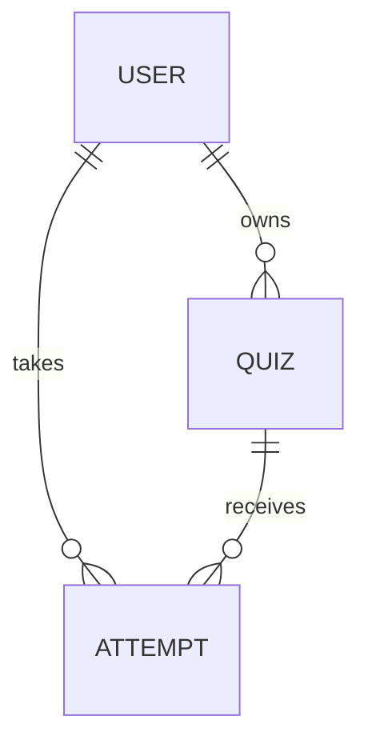
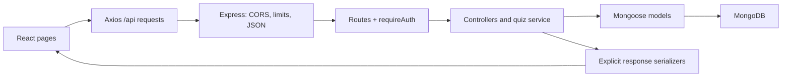

# Quizly backend: architecture and workflow

Quizly lets a signed-in creator publish a multiple-choice quiz, share a link, and see participants' names and scores. Participants sign in, answer independently at their own pace, review their choices, and submit for a final score. The backend provides identity, authorization, permanent quiz storage, attempt isolation, and grading.

The frontend is the sibling `quizzo_frontend` React application. This backend is a CommonJS Node.js application using Express 5, Mongoose 9, MongoDB, and JSON Web Tokens. Password hashing uses Node's built-in scrypt implementation. Self-paced gameplay uses ordinary HTTP requests; it does not need a Socket.IO connection.

The original source review is preserved in [initial-backend-audit.md](initial-backend-audit.md). That file describes the old implementation. This guide describes the new source. Exact browser-facing response shapes are in the [shared API contract](../../quizzo_frontend/documentation/backend-contract.md). See [verification.md](verification.md) for what has actually been run; source implementation and verified database behavior are separate claims.

## 1. The complete user journey

1. **Register:** the browser sends a name, email, and password. The server validates them, normalizes the email, hashes the password, and saves a User. It returns only the safe profile.
2. **Sign in:** the server verifies the password and returns a signed, expiring token plus the profile. The browser stores the token and restores the current user through `GET /api/auth/me`.
3. **Draft:** the creator writes a title, description, questions, options, and one correct option for each question. Draft edits remain in account-scoped browser storage.
4. **Publish:** Save quiz & get link sends the finished content to `POST /api/quizzes`. The server derives ownership from the token, assigns MongoDB question IDs and a random share ID, and persists the quiz.
5. **Share:** the frontend combines its own origin with `/q/:shareId`. A signed-out visitor is taken through sign-in and returned to that link.
6. **Start:** after an authenticated visitor reads the quiz introduction, Start creates an Attempt. It records their account, display name, quiz version, and a private copy of the questions and answer key.
7. **Answer:** the browser displays questions without the answer key. Unfinished selections stay in browser storage under the user and attempt ID. Navigating questions does not call the server.
8. **Submit:** the browser sends question IDs and chosen option indexes. The server validates the complete answer set, grades its private snapshot, and atomically records the final answers, result, and completion time.
9. **Read results:** the participant can reload their own result. The creator opens My quizzes → a quiz to see completed attempts, participant names, scores, and averages.

Owners may also take their own quizzes. Retakes are allowed and create separate attempts. Scores are final once submitted. There is no timer, synchronized host session, negative marking, or multiple-correct-answer question type in this version.

## 2. What a shared link stores

```text
https://quizly.example/q/aRandomServerGeneratedCode
                         └── shareId
```

The link contains only an opaque lookup identifier. The quiz object stays in MongoDB. The link does not encode questions, correct answers, a participant, a score, a JWT, or a socket ID.

The server generates 18 random bytes and encodes them as a 24-character URL-safe string. A unique database index prevents duplicate share IDs. Everyone using that link resolves the same published quiz. Each Start operation with a new request key creates an independent Attempt; the original quiz is not mutated by somebody's answers.



The creator's result table queries the Attempt collection by quiz ID. Participants are not appended to a growing array inside the Quiz document.

A localhost link works only on the machine where that hostname is resolved. For other people to use a link over the internet, deploy the frontend and API to a reachable HTTPS origin with a shared MongoDB database. Opening a local page does not publish it to the internet.

## 3. Application layers and request flow



| Layer / file | Responsibility |
| --- | --- |
| [app.js](../app.js) | `createApp(config)`, middleware ordering, route mounts, health endpoint, optional built frontend, JSON errors. Importing it does not start a server. |
| [env.js](../env.js) | Loads the backend environment, checks port/secret/origins, and produces one configuration object. |
| [server.js](../server.js) | Connects and creates indexes before listening; owns HTTP startup and graceful shutdown. |
| [db.js](../db.js) | Mongoose connection/disconnection and declared index creation. Does not delete existing indexes or collections. |
| [routes/auth.routes.js](../routes/auth.routes.js) | Signup, sign-in, current profile. |
| [routes/quiz.routes.js](../routes/quiz.routes.js) | Authenticated quiz publication, owned list, owner detail, owner results. |
| [routes/shared.routes.js](../routes/shared.routes.js) | Authenticated shared-link introduction and attempt start. |
| [routes/attempt.routes.js](../routes/attempt.routes.js) | Participant-owned attempt reads and submission. |
| [middlewares/requireAuth.js](../middlewares/requireAuth.js) | Verifies bearer token and loads the current User. Sets `req.user`. |
| [middlewares/authRateLimit.js](../middlewares/authRateLimit.js) | Bounded process-local limits on signup/sign-in POST requests. |
| [controllers/auth.controller.js](../controllers/auth.controller.js) | Account validation, duplicate handling, sign-in, legacy password migration, safe profile responses. |
| [controllers/user.create.controller.js](../controllers/user.create.controller.js) | Hashes a new password and creates a User. |
| [controllers/jwt.maker.controller.js](../controllers/jwt.maker.controller.js) | Signs expiring HS256 tokens with user ID as subject. |
| [controllers/quiz.controller.js](../controllers/quiz.controller.js) | Publishes quizzes and constructs owner/participant views and result tables. |
| [controllers/attempt.controller.js](../controllers/attempt.controller.js) | Idempotent starts, participant authorization, snapshot-based grading, atomic finalization. |
| [services/quizzes.js](../services/quizzes.js) | Share IDs, legacy share migration, owned/shared lookup, completed-attempt aggregates. |
| [lib/validation.js](../lib/validation.js) | Strict request types, field limits, identifier/key validation, answer-set validation and scoring. |
| [lib/passwords.js](../lib/passwords.js) | Salted scrypt hashes, constant-time comparison, old plaintext comparison for migration only. |
| [lib/mongo-config.js](../lib/mongo-config.js) | Parses connection-string syntax without network access and rejects copied Atlas credential placeholders with secret-free errors. |
| [lib/serializers.js](../lib/serializers.js) | Whitelisted user/quiz/attempt responses. Participant questions omit correct answers. |
| [lib/errors.js](../lib/errors.js) | Application errors and consistent JSON error mapping; avoids logging bodies, tokens, or database payloads. |
| [scripts/local-mongo.js](../scripts/local-mongo.js) | Loads optional local MongoDB tooling and selects its binary cache. |
| [scripts/dev-local.js](../scripts/dev-local.js) | Starts an official local MongoDB process with persistent development data and a generated local signing secret. |
| [tests](../tests) | Unit/HTTP checks plus the separate real-MongoDB integration suite. |

Old `controllers/SocketController.js`, `controllers/qtable.create.controller.js`, `controllers/quiz.create.controller.js`, and `models/qtable.model.js` remain as unused historical files. Nothing in the active route tree imports them. Their old console messages and schemas do not describe current gameplay. The existing Socket.IO, mongodb-driver, and js-cookie manifest entries were retained; current gameplay uses Mongoose and HTTP.

## 4. Database records

### User: models/users.model.js

Registered model name: `user`. Collection: `users`. Retaining these names and existing IDs preserves ownership of old quizzes.

| Field | Meaning |
| --- | --- |
| `_id` | Stable account ID, also used as JWT subject. |
| `name` | Display name, up to 80 characters. Old accounts fall back to the email's local part. |
| `email` | Profile email. Newly registered accounts are trimmed/lowercased. |
| `emailCanonical` | Private normalized login key, with a unique partial index for string values. |
| `passwordHash` | Private `scrypt$v1$salt$hash` string. New accounts must have a hash. |
| `password` | Hidden legacy-only field, removed after a successful verified upgrade. |
| `quizzes_created` | Retained legacy array. Current ownership is determined by `Quiz.owner`; this array is not maintained. |
| `createdAt`, `updatedAt` | Mongoose timestamps. |

The separate partial index allows existing legacy accounts without a canonical key to remain in place. Signup checks canonical and case-insensitive legacy emails before insertion, and the unique canonical index handles concurrent registrations.

### Quiz: models/quizzes.model.js

Collection: `quizzes`.

A quiz stores `owner`, `title`, optional `description`, `questions`, `shareId`, `version` (currently 1), `publishedAt`, and timestamps. The owner reference points to the registered `user` model.

Questions are embedded using [question.schema.js](../models/question.schema.js). Each has its own `_id`, `text`, ordered `options` array, and zero-based `correctOption`.

Published title, description, questions, owner, and version are marked immutable in Mongoose, and there is no update/delete endpoint. Future editing of published quizzes should create a new version. The existing UI edits drafts only.

Indexes: unique partial `shareId`; compound `owner + createdAt` for the owned list. Legacy saved quizzes without a share ID receive one when their owner lists or opens them, preserving their document IDs and questions.

### Attempt: models/attempts.model.js

Collection: `attempts`.

| Field | Meaning |
| --- | --- |
| `quizId`, `quizVersion` | Published quiz/version this attempt belongs to. |
| `userId`, `participantName` | Authenticated participant ID and a display-name snapshot. The request cannot choose another identity. |
| `quizTitle`, `shareId` | Quiz metadata at start, for player/result views. |
| `startRequestId` | Client request key scoped to this user and quiz. |
| `snapshot` | Private immutable questions/options/answer key copied at start; excluded from ordinary queries. |
| `status` | `in_progress` or `submitted`. |
| `answers` | Final `{ questionId, optionIndex }` selections; initially empty. |
| `result` | After submission: `{ score, totalQuestions, percentage }`. |
| `startedAt`, `completedAt` | Start time and optional finalization time. |

Indexes:

- Unique `(quizId, userId, startRequestId)`: makes concurrent start retries converge on one record.
- `(quizId, status, completedAt)`: owner results.
- `(userId, startedAt)`: participant lookup support.

The private snapshot is deliberately separate from the current quiz document. Even an administrative change outside the published-quiz API cannot change the key used to grade an already-started attempt.

## 5. API surface

All paths below return JSON. Only signup, sign-in, and health are public. Protected requests require `Authorization: Bearer <token>`.

| Method and path | Called by | Successful response |
| --- | --- | --- |
| POST `/api/auth/signup` | Signup form | 201 `{ user }` |
| POST `/api/auth/signin` | Sign-in form | 200 `{ token, user }` |
| GET `/api/auth/me` | Session restoration / login | 200 `{ user }` |
| POST `/api/quizzes` | Save quiz & get link | 201 `{ message, quiz }` summary including share ID |
| GET `/api/quizzes` | My quizzes/dashboard | 200 `{ quizzes }`, current owner's summaries |
| GET `/api/quizzes/:quizId` | Owner quiz detail | 200 `{ quiz }`, including owner-only questions/key |
| GET `/api/quizzes/:quizId/attempts` | Owner results / Refresh | 200 `{ attempts }`, completed results only |
| GET `/api/shared/quizzes/:shareId` | Participant introduction | 200 `{ quiz }`, metadata only |
| POST `/api/shared/quizzes/:shareId/attempts` | Start quiz | 201 new / 200 retry `{ attempt }`, safe questions |
| GET `/api/attempts/:attemptId` | Player/result page | 200 `{ attempt }`, current participant only |
| POST `/api/attempts/:attemptId/submit` | Submit answers | 200 `{ attempt }`, finalized server result |
| GET `/health` | Readiness check | 200 connected / 503 disconnected |

See the [frontend contract](../../quizzo_frontend/documentation/backend-contract.md) for complete response objects.

IDs are serialized as strings; dates become ISO strings. Numeric score/count fields remain numbers. An empty results list is `{ attempts: [] }`, not an error. Summaries count completed attempts, including retakes, and use their average percentage. The owner UI calculates unique participants from returned user IDs.

Errors use `{ "error": "Useful explanation." }`: 400 invalid input, 401 invalid/missing authentication, 403 ownership/origin denial, 404 missing resource, 409 duplicate/conflicting account, 413 oversized JSON body, 429 account request limit, 500 unexpected server failure. Malformed IDs and JSON get explicit responses instead of hanging requests.

## 6. Authentication, authorization, and validation

Signup requires name (1–80 trimmed characters), a valid email (up to 254 characters), and password (8–128 characters). Password whitespace is not trimmed. Sign-in accepts shorter legacy passwords so old users can migrate.

Hashes use scrypt with a random 16-byte salt, N=32768, r=8, p=1, and a 64-byte derived key. Verification uses constant-time comparison. Plaintext credentials, password hashes, and canonical login keys are never included in API profiles.

JWTs use HS256, issuer `quizly`, audience `quizly:web`, and the user ID as subject. Default lifetime is seven days. Middleware restricts algorithm/issuer/audience and loads the current account, so a token for a missing user is rejected. Tokens are not stored in a database. Sign-out currently removes the browser token; there is no revocation or refresh-token endpoint.

Authorization is enforced on the server:

- Quiz detail and full result lists require `quiz.owner === req.user._id`.
- Attempt read/submit requires `attempt.userId === req.user._id`, even for the quiz's creator.
- Shared-link requests still require authentication.
- Shared intros contain no questions. Start/read/submit participant payloads contain safe questions but never `correctOption` or `snapshot`.
- The server assigns quiz owner and attempt participant identity. Extra client fields cannot choose these values.

Quiz limits are 150 title characters, 2,000 description/question characters, 1–200 questions, and 2–10 options per question. Options must be nonempty, distinct ignoring case/outer whitespace, and at most 500 characters. The correct choice must be an integer within the options array.

Signup/sign-in share a per-IP allowance of 40 POST requests per 15-minute window, counting successes and failures. The in-process store is capped at 10,000 clients and returns 429 at capacity. It resets on restart and is not a distributed rate limiter. Deployments with multiple API instances should enforce shared limits at their gateway. Forwarded addresses are ignored unless one trusted proxy is explicitly configured.

## 7. Grading and retry behavior

The start and submit endpoints require an `Idempotency-Key` of 1–128 letters, digits, dots, underscores, colons, or hyphens.

A start key is unique within one authenticated user and quiz. If two requests race, the unique index selects one inserted record; the losing request fetches that record. A different key means a new attempt/retake.

Submission validates that:

1. The body contains exactly as many answers as the attempt has questions.
2. Every expected question ID appears exactly once.
3. No missing, duplicate, or foreign question is present.
4. Every selected index is an integer in that question's options array.

The server awards one point for each matching answer and calculates `Math.round(score / totalQuestions * 100)`. Client-supplied score/result fields are ignored.

Finalization uses one conditional `findOneAndUpdate` matching `status: "in_progress"`. Answers, score, completion time, and submitted status are written together. A concurrent request that loses this update returns the already-finalized attempt. Later retries return that same result, even if their selected answers differ. Submission finality is enforced by attempt ID and status, not by retaining a second cache of submit keys.

Quiz publication itself is not idempotent: an uncertain save timeout can leave a saved quiz even if the response was lost. The UI retains the draft and tells the creator to check My quizzes before retrying.

## 8. Existing accounts and quizzes

Startup does not wipe, merge, or reseed existing data.

On a correct legacy plaintext-password login, the server writes a scrypt hash, canonical email, and display name and removes the plaintext field. Incorrect passwords cannot trigger migration. The user ID stays the same, so owned quizzes stay attached.

When multiple old accounts match one normalized email, sign-in returns 409 for an administrator to resolve. The server does not guess which account to merge or delete. If old records themselves contain invalid quiz content, correct those records deliberately; this migration does not silently rewrite questions.

Old JWTs lacking the new subject/issuer/audience must be replaced by signing in again. Old quizzes gain share IDs lazily through owner access. The obsolete `quizzes_created` array remains untouched; `Quiz.owner` is authoritative.

## 9. Frontend integration and hosting

The frontend's [Auth_Handler.jsx](../../quizzo_frontend/src/api/Auth_Handler.jsx) and [Quiz_Handler.js](../../quizzo_frontend/src/api/Quiz_Handler.js) use the shared Axios client. In normal mode all workflow requests reach this API; there is no automatic fallback to demo data.

The default browser base URL is empty, so requests use the page's own `/api` path:

- During Vite development/preview, `vite.config.js` proxies `/api` to `VITE_BACKEND_URL`, default `http://127.0.0.1:4444`.
- With a built frontend, Express can serve its sibling `dist` and the API on the same origin.
- If the API is hosted separately, build the frontend with `VITE_API_URL` set to that public API origin and configure the frontend origin in backend `CORS_ORIGIN`.

Express serves `index.html` for client-side routes such as shared links and result pages, so opening or refreshing them directly works. Unknown `/api` paths keep their JSON 404 rather than receiving HTML. API responses use `Cache-Control: no-store`.

CORS permits configured origins and the request's own origin. This allows normal same-origin POSTs when the backend serves the frontend. CORS controls browser access; it does not replace bearer-token authorization.

Local-network HTTP pages have a cryptographic request-ID fallback for browsers without `crypto.randomUUID`. Clipboard copying also has a manual-copy fallback. Public deployments should use HTTPS.

## 10. Running and configuring the project

The [README](../README.md) provides the exact commands for both a persistent local MongoDB helper and an existing MongoDB server.

| Variable | Meaning / default |
| --- | --- |
| `PORT` | API / optional whole-app port, default 4444. |
| `HOST` | Listen address, default 127.0.0.1. Use 0.0.0.0 when deployment or intentional LAN access requires it. |
| `MONGOURL` | Standard MongoDB URI; default local `quizzo_db` database on port 27017. |
| `JWT_SECRET` | Required private backend secret. Production requires at least 32 characters. |
| `JWT_TTL` | jsonwebtoken expiry duration, default `7d`. Use an explicit unit, e.g. `1h`. |
| `CORS_ORIGIN` | Comma-separated exact browser origins, default localhost/127.0.0.1 on 5173. No paths or trailing slash. |
| `SERVE_FRONTEND` | `true` serves sibling frontend `dist`; defaults to true in production and false otherwise. Missing build fails startup. |
| `TRUST_PROXY` | `1` trusts exactly one reverse proxy; otherwise forwarded identity/protocol headers are ignored. |
| `TEST_MONGO_URL` | Optional integration-test MongoDB server. The test overrides its database name with an isolated random name. |
| `MONGOMS_DOWNLOAD_DIR` | Optional binary cache override for local MongoDB tooling. Default backend `.cache/mongodb`. |

`npm run dev:local` overrides the MongoDB URL and signing secret with a loopback MongoDB process on port 27027 and a generated secret under `.local`. Its WiredTiger files persist under `.local/mongodb`; they are not an in-memory substitute. The optional tool manages an official MongoDB executable. The initial package/binary download requires network access. This convenience runner is for development, not deployment.

The server waits for database connectivity and indexes before it announces readiness. Shutdown stops HTTP traffic, disconnects Mongoose, and stops the local MongoDB child process when the convenience runner owns it.

## 11. Tests and current boundaries

`npm test` runs fast Node tests for validation, hashing, JWT claims, private-field serialization, real HTTP failure paths, CORS, account limits, configuration, and SPA routing. It needs no live database.

`npm run test:integration` uses an isolated real MongoDB database and actual frontend API modules loaded through Vite. It covers registration/sign-in, published quiz ownership, separate participants/retakes, hidden keys, concurrent starts/submissions, malformed answers, ignored forged scores, stable results, legacy upgrades, and restart persistence. It requires both folders' npm dependencies plus optional local MongoDB tooling or `TEST_MONGO_URL`. Only the test's generated database is dropped. The application database is never selected for cleanup.

If Atlas is already configured in the backend `.env`, `npm run test:configured-db` explicitly uses that saved `MONGOURL` for the same isolated suite, without installing a local MongoDB executable. `TEST_MONGO_URL` takes precedence when set. Both startup and this command reject literal Atlas credential placeholders before connecting. The configuration mismatch discovered during verification has been corrected, but the latest Atlas retry still fails with DNS `ETIMEOUT`; see the verification report below for the precise status.

See [verification.md](verification.md) for executed results and outstanding environment blockers.

The requested self-paced API is implemented. Future scope includes password recovery/email verification, token revocation, server-side draft/progress synchronization, published-quiz editing/version management, delete/archive, pagination, live notifications, and deployment provisioning. Current list endpoints return all owned quizzes or completed attempts; large installations need pagination and shared request limits.

A useful reading order is `app.js → routes → requireAuth → controller → service/validation → model → serializer`, followed by the corresponding frontend API helper and page.
